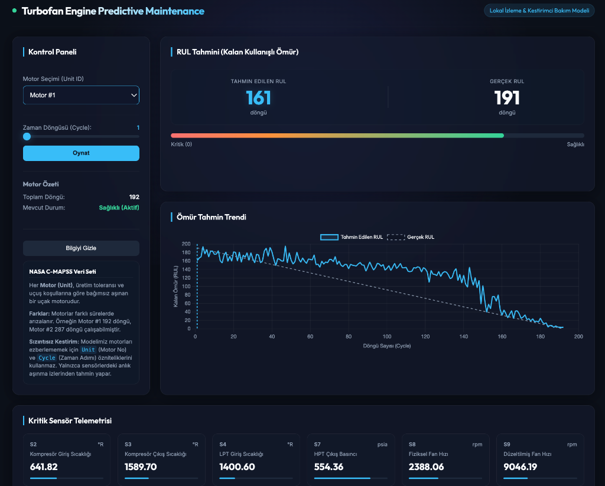

# Turbofan Motoru Kestirimci Bakım (Predictive Maintenance)

Bu proje, NASA'nın ünlü **C-MAPSS** (Turbofan Engine Degradation Simulation) veri setini kullanarak uçak motorlarının Kalan Kullanışlı Ömrünü (Remaining Useful Life - RUL) tahmin eden ve bunu lokalde çalışan modern, etkileşimli bir web arayüzünde görselleştiren bir uçtan uca makine öğrenimi uygulamasıdır.



---

## 🚀 Proje Özellikleri

* **Gerçek Zamanlı İzleme Arayüzü:** Koyu tema (Sleek Dark Mode) ve cam efekti (Glassmorphism) ile geliştirilmiş premium kullanıcı arayüzü.
* **Zaman Serisi Simülasyonu:** Seçilen motorun döngüleri (Cycles) arasında slider ile manuel geçiş yapabilme veya "Oynat/Durdur" butonları ile telemetri sürecini simüle edebilme.
* **Dinamik RUL Göstergeleri:** Tahmin edilen RUL ile gerçek RUL değerlerini gösteren, kalan ömre göre renk değiştiren (Yeşil ➔ Turuncu ➔ Kırmızı) gösterge barları.
* **Bakım Uyarı Mekanizması:** Motorun kalan ömrü 20 döngünün altına indiğinde ekranın sağ üstünde otomatik beliren ve yanıp sönen kırmızı neon bakım alarmı.
* **Gelişmiş Grafik Entegrasyonu (Chart.js):** Gerçek RUL ile tahmin edilen RUL'un tüm döngüsel seyrini gösteren ve slider çizgisine göre anlık güncellenen interaktif grafik.
* **Sensör Telemetri Grid:** Seçilen döngüdeki anlık sensör değerlerini (Sıcaklık, Basınç, Fan Hızı vb.) fiziksel birimleriyle ve motorun çalışma sınırlarına göre normalize edilmiş oransal çubuklarla izleme.

---

## 🛠️ Metodoloji ve Model İyileştirmeleri

Orijinal notebook üzerinde yapılan detaylı inceleme sonucunda aşağıdaki geliştirmeler uygulanmıştır:

1. **Sentaks ve Kütüphane Hatalarının Giderilmesi:**
   * Sınıflandırma modelindeki `skleairn` yazım hatası giderilerek `sklearn` olarak düzeltilmiştir.
   * `fillna` fonksiyonundaki kalıcı olmama (inplace) problemi giderilmiştir.
2. **Veri Sızıntısının (Data Leakage) Önlenmesi:**
   * Modeller eğitilirken `Unit` (Motor ID) ve `Cycle` (Zaman Döngüsü) sütunları öznitelik setinden çıkarılmıştır. Bu sayede modelin motor kimliklerini veya zamanı doğrudan ezberlemesi engellenmiş, yıpranma trendlerini sadece sensörlerden öğrenmesi sağlanmıştır.
3. **Gerçekçi Doğrulama Stratejisi (GroupKFold):**
   * Standart rastgele K-Fold yerine **GroupKFold** kullanılarak motor bazlı gruplama yapılmıştır. Böylece modelin eğitimde hiç görmediği motorlar üzerindeki başarısı test edilmiştir.

### 📊 Deneysel Performans Sonuçları (Random Forest)

| Model Versiyonu | MAE (Hata Oranı) | $R^2$ Skoru | Yorum |
| :--- | :---: | :---: | :--- |
| **1. Sızıntılı Model (Baseline)** | 18.83 Döngü | %85.93 | `Cycle` özniteliğini ezberleyerek yanıltıcı yüksek başarı gösterir. |
| **2. Sızıntısız Model (KFold)** | 29.63 Döngü | %63.34 | Sızıntı giderilmiş, sadece sensör verilerini temel alan gerçek performanstır. |
| **3. Sızıntısız Model (GroupKFold)**| **30.21 Döngü** | **%61.85** | Sisteme eklenecek tamamen **yeni bir motor** üzerindeki gerçek doğruluk payıdır. |

---

## 💻 Kurulum ve Çalıştırma

Uygulamayı lokal bilgisayarınızda çalıştırmak için aşağıdaki adımları takip edebilirsiniz:

### 1. Gereksinimlerin Yüklenmesi
Proje dizininde bir sanal ortam oluşturup gerekli kütüphaneleri kurun:
```bash
# Sanal ortam oluşturma
python3 -m venv venv
source venv/bin/activate

# Gerekli paketleri kurma
pip install pandas scikit-learn matplotlib seaborn fastapi uvicorn joblib
```

### 2. Modellerin Eğitilmesi
Verileri temizleyen, sızıntısız modelleri eğiten ve kaydeden scripti çalıştırın:
```bash
python train_and_save.py
```
Bu işlem sonunda dizinde `rul_regressor.joblib`, `rul_classifier.joblib` ve `scaler.joblib` dosyaları oluşacaktır.

### 3. API Sunucusunun ve Arayüzün Başlatılması
FastAPI sunucusunu başlatın:
```bash
uvicorn backend:app --host 127.0.0.1 --port 8000
```

### 4. Tarayıcıda Görüntüleme
Sunucu başladıktan sonra tarayıcınızı açarak aşağıdaki adrese gidin:
👉 **[http://127.0.0.1:8000](http://127.0.0.1:8000)**
